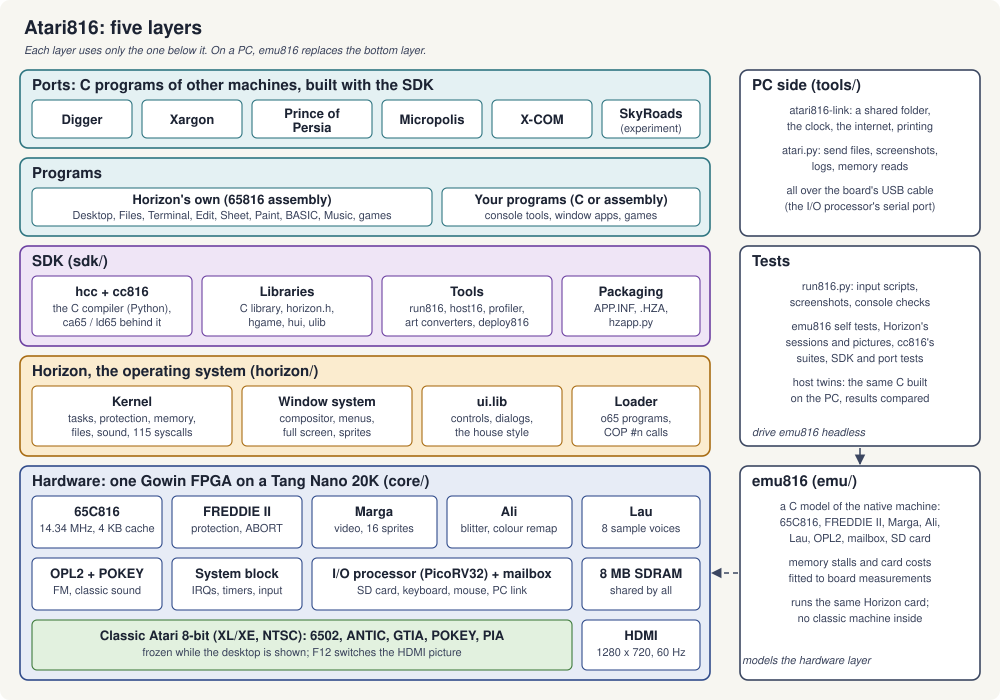

# Architecture and components

The Atari816 is a 16-bit computer built around the 65C816, in one FPGA on a Sipeed Tang Nano
20K, with a complete classic Atari 8-bit beside it. On top of the hardware run Horizon, its
own operating system, Horizon's programs, and programs built with the SDK, among them ports
of six PC games. An emulator models the hardware so that all of the software can be built
and tested on a PC.

This section describes the whole system, one page per layer, and how it is tested:

| Page | What it covers |
| --- | --- |
| [hardware.md](hardware.md) | the FPGA design: the 65C816, FREDDIE II, Marga, Ali, Lau, the OPL2, POKEY, the system block, the I/O processor and the mailbox, the SD card, HDMI, the classic Atari |
| [horizon.md](horizon.md) | the operating system: boot, tasks and protection, system calls, files, the window system, the programs on the card |
| [emulator.md](emulator.md) | emu816: what it models, the board-timing models, what it does not model |
| [sdk.md](sdk.md) | the compiler, the libraries, the tools, packaging |
| [solid.md](solid.md) | how every part is tested, with the counts of a run from a fresh tree |

## The layers

**Hardware** (`core/`). A Gowin GW2AR-18 FPGA with 8 MB of SDRAM. The native machine is a
65C816 at 14.34 MHz with a 4 KB cache and its own chips: FREDDIE II (memory protection),
Marga (video), Ali (the blitter), Lau (an 8-voice sample player), an OPL2 FM synthesizer,
and the classic machine's POKEY on loan. A PicoRV32 I/O processor serves the SD card, the
keyboard and mouse and the link to a PC, through a mailbox in main RAM. Next to all this is
an Atari 800XL/130XE-class machine (Mark Watson's atari800core) that runs original 8-bit
software on its own hardware. [hardware.md](hardware.md)

**Horizon** (`horizon/`). A preemptive kernel with memory protection, written in 65816
assembly: tasks in 64 KB banks with private stacks, 115 system calls through `COP #n`, a
window system with its own compositor, menus, full-screen modes with sprites and scrolling,
and a controls library. The programs on the card include a desktop, a file manager, a
terminal and shell, text editors, a spreadsheet, a paint program, BASIC, a music player,
an installer and games. [horizon.md](horizon.md)

**The SDK** (`sdk/`). cc816, a C compiler written for this machine, and `hcc`, the one
command that builds a program; the C library, every syscall as a C function, a game library
and a window-application library; Python tools to run programs in the emulator under
scripts, to compare a port with its PC twin, to profile, to convert art and to pack apps.
[sdk.md](sdk.md), and the SDK's own manual: [sdk/docs/README.md](../../sdk/docs/README.md).

**Programs and ports** (`ports/`). Six ports of PC games, built with the SDK and tested in
the emulator against their PC originals: Digger, Xargon, Prince of Persia, Micropolis
(the SimCity simulator), X-COM (the XCOM-XT engine) and SkyRoads (an experiment that plays
the attract demo). Digger's and Micropolis' data are in the repository; Xargon, Prince of
Persia, X-COM and SkyRoads need the game's files, which their `make data` fetches or takes
from your own copy (X-COM: your own copy only). Each port's README says what it
demonstrates.

**The emulator** (`emu/`). emu816 boots the same Horizon card as the board. Its CPU passes
the SingleStepTests suite; FREDDIE II, the mailbox and Marga follow the RTL line by line;
its memory stalls and the SD card's costs were fitted to measurements on the board.
[emulator.md](emulator.md)

**The PC side** (`tools/`, `core/tools/`). `atari816-link` shares a folder of the PC with
the Atari816 and brings it the clock, the internet and printing, over the USB cable that
powers the board; `core/tools/atari.py` sends files, takes screenshots and reads the log
and memory. The protocol: [Docs/04-pc-link.md](../04-pc-link.md).

## One request, end to end

How the layers work together, on the example of a C program reading a file:

1. The program calls `fread`. The C library (`sdk/c/lib/stdio.c`) has nothing buffered,
   so it calls `hz_read`, a stub that loads A, X and Y and executes `COP #$22`.
2. The 65C816 fetches the COP vector. FREDDIE II switches to supervisor mode in hardware;
   the kernel moves to the task's kernel stack.
3. The kernel checks that the buffer lies in a bank the task owns and may write, and that
   it does not cross a bank boundary. It writes a READ message into the request ring in
   main RAM and blocks the task. Other tasks run.
4. The I/O processor sees the new ring head, reads the sectors through FatFs and writes
   the bytes straight into the program's buffer in SDRAM. It writes the answer into the
   response ring; the hardware sweeps the 65C816's cache before the new head becomes
   visible, so the CPU never reads stale bytes.
5. The answer raises the IOP interrupt. The kernel matches it to the task by its tag, sets
   A and the carry, and returns to user mode with RTI. `fread` returns.

In the emulator the same five steps run against `mailbox.c` and a folder on the PC, with
the card's per-request cost charged as the board's firmware would take it.

## Numbers at a glance (release 0.31)

| | |
| --- | --- |
| CPU | 65C816, 14.34375 MHz, 4 KB direct-mapped cache |
| Memory | 8 MB SDRAM, 128 banks of 64 KB; 4 open files in the whole system |
| Screen | 640 x 360 x 8 bpp desktop on 1280 x 720 HDMI at 60.03 Hz; also 640 x 360 x 4 and 320 x 180 x 8 |
| Sound | Lau: 8 voices of 8- or 16-bit samples; OPL2: 9 FM channels; POKEY: 4 voices |
| Horizon | 115 system calls; 16 task slots; about 23,900 lines of kernel assembly |
| Hardware revision | $0D by default (REV $0C is the one run on the board so far) |

The design document that started the project, with the decisions taken and the parts still
planned, is [Docs/01-architecture-design.md](../01-architecture-design.md); the register
specification is [Docs/02-register-spec.md](../02-register-spec.md).
