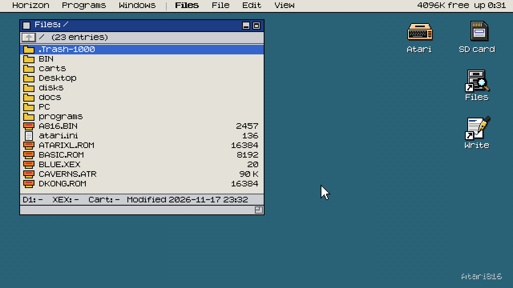
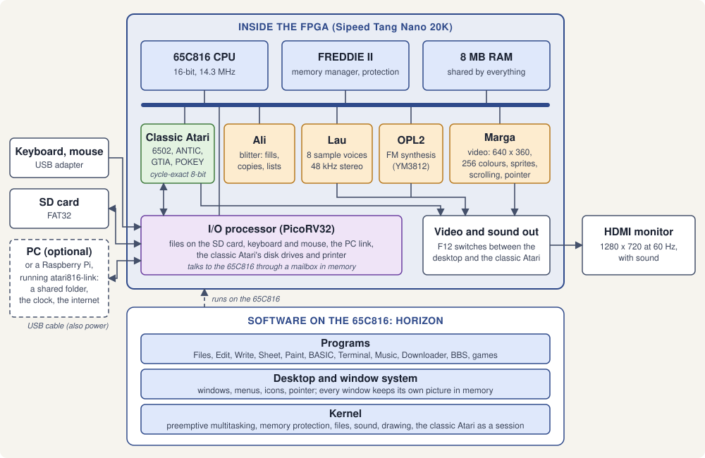

# Atari816 + Horizon OS

**A 16-bit Atari and desktop on the 65C816, with original 8-bit Atari compatibility.**

The Atari816 is a new 16-bit Atari designed around the 65C816. It has its own operating
system (Horizon), its own programs, an emulator and an SDK, and it runs on a Sipeed Tang Nano
20K FPGA board. Horizon is a preemptive multitasking kernel with memory protection and a
mouse-driven desktop (windows, icons, a terminal, and applications such as Files, Edit,
Write, Sheet, Paint, BASIC, a Downloader and a BBS terminal). The machine's custom chips are
FREDDIE II (the memory manager), Marga (video), Ali (the blitter) and Lau (an 8-voice
sample player), with an OPL2 FM synthesizer (YM3812) and the classic machine's POKEY.

Inside the same FPGA is a complete, cycle-exact Atari 8-bit computer (400/800/XL/XE), so
original 8-bit software runs on its own hardware. F12 switches between it and the desktop.



*The Horizon desktop, captured from a Tang Nano 20K (640 x 360, 256 colours).*

## How it works



- One FPGA holds two computers. The 16-bit machine is a 65C816 with 8 MB of RAM and its own
  chips: Marga generates the picture, Ali copies and fills pixels, and Lau, an OPL2 and
  POKEY produce the sound. Beside it is a complete classic Atari 8-bit that runs original
  software unchanged.
- FREDDIE II controls which task may access which memory. It protects programs from each
  other and gives the classic Atari its own 64 KB view of the same RAM.
- A small I/O processor handles the slow devices: files on the SD card, the keyboard and
  mouse, the link to the PC, and the classic Atari's disk drives and printer. The 65C816
  sends it requests through a mailbox in memory and continues running until the response
  arrives.
- Horizon is the software on the 65C816: a kernel, a desktop with windows, and the
  programs. F12 switches the screen between the desktop and the classic Atari.
- The SDK runs on the PC and builds programs for Horizon in C and assembly. It has cc816, a
  C compiler for the 65C816 (programs larger than 64 KB, with code in several banks), a C
  library, hui for window programs and hgame for games, the emu816 emulator for tests,
  profiling and debugging, and tools for art, packaging and deployment. Digger, X-COM and
  Micropolis were ported with it. See [`sdk/`](sdk/README.md).
- Lau plays sampled sound without the CPU. The Music program plays ProTracker modules
  (.MOD) and sound files (.WAV) from the card, the PC or the internet, without breaks while
  you work in other windows. Two original songs are on the card in `/Music`.
- The PC link is optional. With the gateway running on a PC, the Atari816 gets a shared
  folder, the time and the internet through the same USB cable that powers the board.

More detail: [`Docs/01-architecture-design.md`](Docs/01-architecture-design.md) (the design),
[`Docs/02-register-spec.md`](Docs/02-register-spec.md) (every register).

## Status

Release 0.31 (November 2026). Everything below works and is in active development.
Interfaces can still change.

- Hardware (`core/`): the 65C816 machine and its chips beside a cycle-exact Atari 8-bit, on
  a Tang Nano 20K. Runs on the board. Known faults are in
  [`core/KNOWN_ISSUES.md`](core/KNOWN_ISSUES.md).
- OS and apps (`horizon/`): Horizon, a preemptive, memory-protected kernel with 115
  syscalls, a desktop and its programs. Runs on the board and in the emulator, and is
  tested in the emulator (`make -C horizon test`).
- Emulator (`emu/`): emu816, the native machine with the board's timing (memory stalls, the
  card), headless or in a window. All automated tests run on it. Its timing model is fitted
  to measurements on the board ([`emu/README.md`](emu/README.md)).
- SDK and compiler (`sdk/`): cc816 (the SDK's own C compiler), the C library, the game and
  window libraries, the tools, the test framework, app packaging. Tested in the emulator
  (`make -C sdk test`). See [the SDK manual](sdk/docs/README.md).
- Ports (`ports/`): Digger, Xargon, Prince of Persia, Micropolis, X-COM (XCOM-XT), and a
  SkyRoads experiment, each with its tests. All but Digger and Micropolis need the user's
  own game files.

Architecture, components and verification: [`Docs/architecture/`](Docs/architecture/README.md).

## Repository layout

- [`core/`](core/): the hardware. The FPGA design for the Tang Nano 20K (the Atari 8-bit
  core, the 65C816 native machine in `core/src/a816/`), the I/O processor firmware and
  PC-side tools.
- [`horizon/`](horizon/): Horizon, the operating system, and its programs (65816 assembly,
  ca65/ld65).
- [`emu/`](emu/): emu816, a C emulator of the native machine, for development on a PC.
- [`sdk/`](sdk/): the SDK ([its manual](sdk/docs/README.md)). Getting-started guide,
  programmer's reference, templates, examples, tools. The C SDK with its own compiler,
  cc816 ([`sdk/c/`](sdk/c/)). Apps that users install from one `.HZA` file
  ([`sdk/docs/apps.md`](sdk/docs/apps.md)).
- [`ports/`](ports/): programs ported to Horizon in C with the SDK, each with its porting
  notes and tests: Digger, Xargon, Prince of Persia, Micropolis (`ports/simcity`), X-COM
  (XCOM-XT), and the SkyRoads experiment.
- [`tools/`](tools/): `atari816-link`, the PC side of the PC link (shares a folder of the
  PC with the Atari816, and connects it to the internet).
- [`Docs/`](Docs/): design documents. The architecture and components
  ([`Docs/architecture/`](Docs/architecture/README.md)), the architecture design, the
  register specification, the bring-up log, the PC link.

## Getting started

- To write programs: [the SDK manual](sdk/docs/README.md).
- In the emulator, without a board: [`sdk/docs/getting-started.md`](sdk/docs/getting-started.md)
  (build `emu/` and `horizon/`, then run Horizon).
- On a Tang Nano 20K: build and flash the hardware as described in
  [`core/README.md`](core/README.md), then prepare a FAT32 SD card with Horizon as described
  in [`sdk/docs/getting-started.md`](sdk/docs/getting-started.md), section 6, and
  [`horizon/README.md`](horizon/README.md).

## PC link

The USB cable that powers the board also connects it to the PC. With the gateway running on
the PC, one folder of the PC appears on the Atari816 as a second volume, `/PC:`: a "PC"
icon on the desktop, a `PC:` folder in Files, usable from the shell and from every program
(copy between the card and the PC both ways, open and save, start programs from it). The
Atari816 also takes the PC's time when the gateway connects, so the clock does not need to
be set by hand.

The gateway also connects the Atari816 to the internet: a URL is a file name. `get
https://example.com/file.zip` in the shell (or `cp https://... /somewhere`, or the Downloader
on the Programs menu) downloads a file. `http://`, `https://` and `ftp://` work. Programs can
open TCP connections (`tcp://host:port`): the BBS program on the Programs menu uses this to
reach the old Atari BBSes that are still on the internet by telnet. The PC handles name
resolution, TLS and certificates, and redirects.

```
pip install pyserial
tools/atari816-link                 # shares ~/Atari816 (made if missing)
tools/atari816-link ~/somewhere     # shares another folder
tools/atari816-link --read-only     # the Atari816 can read, not change anything
tools/atari816-link --no-net        # no internet for the Atari816
```

Leave it running and stop it with Ctrl-C. It detects the board and reconnects when the
board is reset or plugged in again. The icon appears within a few seconds and disappears
when the gateway stops.

- Only that folder is shared. Nothing outside it can be read or changed: `..`, hidden
  names (starting with `.`) and links that point out of the folder are refused.
- The gateway opens no listening network port. It communicates only with the board over
  USB, and with the developer tools through a socket in your runtime folder that only you
  can use. It makes outgoing connections for the Atari816 (the internet is on unless you
  start it with `--no-net`): **programs on the Atari816 can reach whatever the PC can
  reach, including your home network.**
- Without the gateway the Atari816 works as before, and `/PC:` returns "no PC link".
- Linux: your user must be allowed to use the serial port (group `dialout`). Stop the gateway
  before you load a new bitstream with openFPGALoader.

The protocol, for writing another gateway: [`Docs/04-pc-link.md`](Docs/04-pc-link.md).

## Printing and the classic Atari's files

- Printing: Edit, Write, Sheet, BASIC (`LPRINT`, `LLIST`), the shell (`print FILE`) and
  Files (right-click a text file, Print) print. A printout is a text file in `/Printouts` on
  the card, named after the date, the time and the program (`2026-11-18 15.30.12 Edit.txt`).
  The Printer program (Programs menu) lists them, shows them, deletes them and sends them to
  the PC. With the gateway running, each printout is also sent to the PC at once, as a PDF
  in `Printouts/` of the shared folder.
- Classic Atari printing: whatever the 8-bit side prints (`LPRINT`, `LIST "P:"`, a word
  processor) becomes a printout `... Atari.txt` in the same way. A printout ends after 3
  seconds without new text, or when you return to the desktop.
- Folder disk: in the Atari panel, "Folder disk..." presents a folder of the card (default
  `/Atari`) to the 8-bit Atari as an Atari DOS 2 disk (D2: by default). Boot a DOS (DOS 2.0,
  DOS 2.5, MyDOS, SpartaDOS X with its ATARIDOS driver) from D1: as usual: the files of the
  folder are there, and what the Atari saves, renames or deletes there is written back into
  the folder as plain files, shortly after the Atari has closed them. Only files with Atari
  DOS names (`NAME.EXT`, 8 + 3 letters or digits, starting with a letter) are shown, at most
  64, and as many as fit on a 90 KB disk. The panel shows how many were left out. A file
  being written on the Atari never replaces the folder's file until it is complete.
- Run in Atari: right-click a BASIC listing (`.BAS` or `.LST` text, written in Edit with
  Atari BASIC's keywords in capitals) in Files or on the desktop and choose "Run in Atari".
  The 8-bit Atari starts with Atari BASIC, types the program in and runs it. BASIC reports
  the errors of bad lines as usual. No DOS disk is needed (and none is reachable from such a
  run). `LIST "D2:PROG.LST"` on the Atari writes a listing into the folder disk that Edit
  opens.

## ROM images

The Atari OS and BASIC ROM images are not included in this repository and must not be
added to it. To run the 8-bit Atari side on the board you need your own ROM images (see
[`core/README.md`](core/README.md), "SD card").

## Licences

The repository is not under a single licence. Each directory has its own. The full texts
are in [`LICENSES/`](LICENSES/) and [`core/LICENSES/`](core/LICENSES/). See
[`LICENSE`](LICENSE).

- `horizon/`: GPL-3.0-or-later.
- `emu/`: GPL-3.0-or-later. Third-party: `emu/nuked-opl3/`, Nuked OPL3, LGPL-2.1-or-later,
  listed in [`emu/LICENSE`](emu/LICENSE).
- `tools/`: GPL-3.0-or-later.
- `sdk/`: MIT.
- `Docs/`: CC-BY-SA-4.0.
- `core/`, original work: CC-BY-NC-SA-4.0 OR GPL-3.0-or-later, at your option
  ([`core/LICENSE-PORT`](core/LICENSE-PORT)).
- `core/`, third-party components: their own licences, listed in
  [`core/LICENSE`](core/LICENSE).

Bitstreams are for non-commercial use only. The 8-bit Atari core inside the hardware (Mark
Watson's atari800core) is offered by its author for non-commercial use only. Any bitstream
built from `core/`, including published `.fs` files, may therefore be used and shared for
non-commercial purposes only. Commercial use needs permission from Mark Watson and from the
other copyright holders whose licences do not already allow it. `core/LICENSE` explains
this, including the tension between that condition and the GPL of some components.

## Credits

The hardware builds on the work of others (details and licences in
[`core/LICENSE`](core/LICENSE)):

- Mark Watson: the Atari 8-bit core (atari800core, via
  [Atari800_MiSTer](https://github.com/MiSTer-devel/Atari800_MiSTer)).
- Peter Wendrich: the 6502 CPU core (FPGA 64).
- Matthias Reichl and Wojciech Mostowski: cartridge, freezer and PBI logic.
- Sergiy Dvodnenko (srg320), gyurco and nand2mario: the 65C816 CPU core (SNES_FPGA, via
  [SNESTang](https://github.com/nand2mario/snestang)).
- nand2mario: the PicoRV32 I/O subsystem and firmware base (NESTang/SNESTang) and the
  low-latency SDRAM controller.
- Claire Xenia Wolf: PicoRV32 and the PicoSoC UART.
- Bruno Levy: the SD-card SPI driver (learn-fpga).
- ChaN: FatFs.
- Sameer Puri: the HDMI library (hdl-util/hdmi).
- WangXuan95: the SD-card reader.
- Avery Lee: the Altirra palettes.

The emulator, emu816, generates the OPL2's sound with Nuke.YKT's
[Nuked OPL3](https://github.com/nukeykt/Nuked-OPL3) (details in [`emu/LICENSE`](emu/LICENSE)).

## Disclaimer

This is an independent hobby project. It is not affiliated with, endorsed by or sponsored by
Atari. Atari and related names are trademarks of their respective owners and are used here
only to describe compatibility and heritage.
