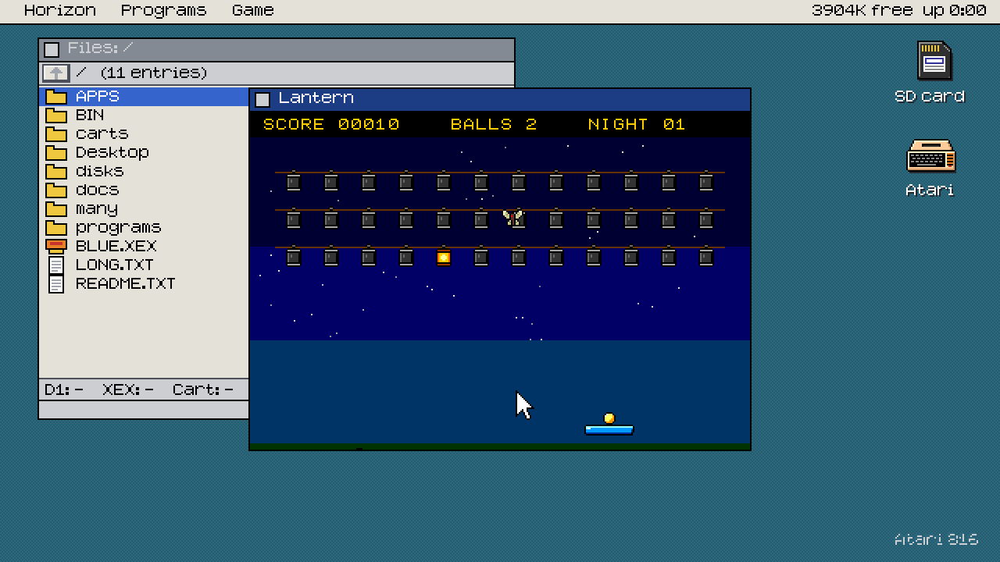

# Atari816 SDK

Tools, libraries and documentation for writing programs and games for the **Atari816** and
its operating system **Horizon**: a getting-started guide, a programmer's reference,
templates, complete examples, PC-side tools (art converters, an emulator runner, a deploy
script for the board) and a skill for coding agents.

**Start here: [the SDK manual](docs/README.md)**. It lists every component (hardware,
Horizon and its ABI, the libraries, the compiler, the tools, the emulator, packaging, the
ports) and which chapters to read for each kind of program.



## Machine

The Atari816 is a 65C816 desktop computer in an FPGA (Sipeed Tang Nano 20K) with a
complete, cycle-exact Atari 8-bit inside it.

- CPU: 65C816 at 14.3 MHz, native mode. Memory stalls make CPU-heavy code run at about
  half the ideal speed. emu816 models them (since Horizon 0.19), and its timings are within
  7 % of the board's.
- Memory: 8 MB in banks of 64 KB, with hardware memory protection between programs.
- Video: Marga. 640 x 360 at 256 colours (8 bpp), shown 2 x 2 on 1280 x 720 HDMI at
  60 Hz, with a 32 x 32 hardware pointer. Also 640 x 360 x 4 bpp and 320 x 180 x 8 bpp
  (all three available to programs in full-screen mode, Horizon 0.18). 16 hardware sprites
  and fine scrolling with wrap and a split (REV $0B).
- Blitter: Ali. Fill, copy, keyed (transparent) copy, 1-to-8 bpp expansion, about 14
  million pixels a second filled and 7.7 million copied. Command lists (draw lists for
  programs, Horizon 0.18).
- Sound: POKEY, the classic machine's sound chip, available while that machine is frozen
  (4 voices: tones, noise). Before REV $0C a second POKEY with four 8-bit DACs, which REV
  $0C removes. Lau, the 8-voice sample player (REV $0A; Horizon 0.17: SYS_SPLAY and related
  calls). The OPL2, a YM3812 FM synthesizer (REV $0C; Horizon 0.27: SYS_OPLW).
- Input: USB keyboard and mouse, two Atari joystick ports (SYS_JOY, Horizon 0.15).
- Storage: SD card, FAT32 with long names.
- Classic machine: an Atari 400/800/XL/XE that runs disk images, executables and
  cartridges. F12 switches between it and the desktop.

**Horizon** is a preemptive multitasking kernel with a window system: a desktop with a menu
bar, windows (each with its own bitmap), icons, a mouse pointer, a terminal, and
applications (Files, Edit, Write, Sheet, Paint, BASIC, a calculator, solitaire, and
Quabricks, a falling-block game). Programs run in user mode and reach the hardware only
through system calls (`COP #n`): 115 of them, for tasks, memory, files, the window system,
drawing, sound, games (full screen, sprites, scrolling, draw lists) and the classic
machine.

## Program types

- Console programs: text in, text out, in the text shell or a Terminal window.
- Desktop applications: windows with menus, buttons, text fields, lists, scroll bars,
  file dialogs and alerts (Horizon's controls library, with the same look as Horizon's own
  programs).
- Games: full screen (Horizon 0.18: the program's own framebuffer in any of Marga's three
  modes, fine scrolling with wrap and a split for a status panel, a raster table, 16
  hardware sprites, draw lists that Ali runs in the vertical blank, its own palette), or in
  a window (blitter sprites over a tile map, or hardware sprites), with keyboard, mouse and
  joysticks, frame sync, POKEY sound effects and sampled sound on Lau (Horizon 0.17).
- Internet programs (Horizon 0.22): through the PC link, a URL (`http://`, `https://`,
  `ftp://`) opens as a read-only file and `tcp://host:port` as a connection. Programs can
  reach whatever the PC can reach, including the home network
  ([docs/reference/internet.md](docs/reference/internet.md)).
- BASIC programs: Horizon BASIC has graphics, sound and the mouse. BASIC 2.0 adds the
  games hardware: sprites with collisions, a scrolling full screen with a panel and raster
  colours, blitter blocks, samples generated or loaded and played by note name.

Programs are written in 65816 assembly with ca65 and ld65 from the cc65 suite, or in C with
the C SDK ([c/](c): its own compiler, cc816, and one command, `hcc`, to build a program;
[docs/c/getting-started.md](docs/c/getting-started.md)). They run in emu816, the machine's
emulator, with scripted input and screenshots. A program can be packed as an app that users
install with a double click ([docs/apps.md](docs/apps.md)). Six programs have been ported
to Horizon in C with this SDK (`ports/` at the repository's top): Digger, Xargon, Prince of
Persia, Micropolis, X-COM (XCOM-XT) and the SkyRoads experiment
([docs/README.md](docs/README.md), "Ports").

## Contents

Documentation:

- [docs/README.md](docs/README.md): the manual's front page. Layers, chapters, where to
  start for each task, the ports.
- [docs/getting-started.md](docs/getting-started.md): install, build the emulator and
  Horizon, hello as a console and a window program, run, screenshot, script input, the
  board.
- [docs/c/](docs/c/getting-started.md): C. Getting started, the reference (memory, the
  code models, calling convention, optimization), porting.
- [docs/c/compiler.md](docs/c/compiler.md): cc816. Its passes, the options by purpose,
  reading its output, diagnostics, limits, its tests, reporting a fault.
- [docs/c/library.md](docs/c/library.md) and [docs/c/syscalls.md](docs/c/syscalls.md):
  every header and function of the C library and the SDK's headers, and every `hz_`
  syscall function (generated from `hzsys.h`).
- [docs/c/apps.md](docs/c/apps.md): desktop applications in C with `hui.h` (windows with
  menus, buttons, fields, lists, scroll bars, the file dialog, alerts, dialogs, callbacks
  into C), linked by hcc when used. A tutorial in five steps
  ([c/examples/guests](c/examples/guests)) and a text viewer
  ([c/examples/viewer](c/examples/viewer)).
- [docs/c/games.md](docs/c/games.md): games in C with `hgame.h` (full screen or a window,
  the blitter, images, sprites, scrolling maps, input, sound, music), `conio.h` and
  `joystick.h`. A tutorial in five steps, Glimmer, Catch, and Gem Run in C
  ([templates/c-game](templates/c-game)).
- [docs/reference/](docs/reference/README.md): the programmer's reference. Program format
  and memory, every syscall with an example, the window system, drawing, the controls
  library, sound, the internet ([internet.md](docs/reference/internet.md)), the games calls
  (full screen, sprites, scrolling, draw lists, palette entries, frame sync:
  [games.md](docs/reference/games.md)), the classic machine, the hardware, performance,
  game patterns, limits.
- [docs/tools.md](docs/tools.md) and [docs/testing.md](docs/testing.md): every tool with its
  options (emu816's too), the `.PRG` format and the linker configurations; automated
  testing.
- [docs/apps.md](docs/apps.md): apps (Horizon 0.29). A program in its own folder in `/APPS`
  with APP.INF, packed into an `.HZA` archive (`tools/hzapp.py`) and installed with a double
  click. `hcc --needs`.
- [docs/roadmap-notes.md](docs/roadmap-notes.md): what is done and what could come later.

C SDK:

- [c/](c): `hcc` (one command from .c files to a program), cc816 (the SDK's C compiler,
  [c/cc816](c/cc816): Python 3 and cc65's ca65, ld65 and ar65, nothing to download), two
  code models (small: one bank; large: code in several banks), the C library on Horizon
  (stdio with files, argc/argv, time, far memory, floating point, `long long`), every
  syscall as a C function (`horizon.h`), examples, tests.

Templates:

- [templates/console](templates/console): arguments, output, a line of input, a file.
- [templates/c-console](templates/c-console): the same in C (hcc, `make` with
  sdk/c/c.mk).
- [templates/window-app](templates/window-app): a window with menus, a text field, buttons,
  the file dialog, an alert.
- [templates/c-window-app](templates/c-window-app): the window-app template in C
  (`hui.h`).
- [templates/game](templates/game): Gem Run. A timer loop, a tile map, keyed-blit sprites
  with dirty rectangles, keys and mouse, POKEY sound, title, play and game-over states.
- [templates/basic-game](templates/basic-game): Starfall, a BASIC 2.0 game. Sprites, HIT,
  the arrows or a joystick, samples, 60 frames a second.

Examples:

- [examples/lantern](examples/lantern): an arcade game with a paddle, ball, lanterns and a
  moth, big letters from a 1 bpp font, and a self-playing demo for its test.
- [examples/slider](examples/slider): a sliding-tile puzzle with mouse and keys, and a
  fanfare.
- [examples/hexview](examples/hexview): a hex viewer. The controls library, a file loaded
  into a bank, scrolling with the blitter, resizing, drag and drop.
- [examples/fetch](examples/fetch): Fetch (Horizon 0.22) prints a URL on the console. A
  URL opened as a read-only file, a message for every error.
- [examples/echo](examples/echo): Echo (Horizon 0.22), a TCP client. Connect, send a line,
  poll for the response.
- [examples/tune](examples/tune): Tune (Horizon 0.26) plays a ProTracker module with the
  replayer library and the music timer.
- [examples/deepdive](examples/deepdive): Deep Dive, a full-screen scrolling game skeleton
  (Horizon 0.18). Its own framebuffer in two banks, fine scrolling with wrap and a split
  panel, one draw list a frame, 15 hardware sprites, its own palette and a raster table,
  Lau samples, pause on focus loss.

Tools and skill:

- [tools/](tools): `run816.py` (runs a program in the emulator with input scripts,
  screenshots, checks, sound logs), `inputscript.py`, `contact.py` (screenshots on one
  sheet), `img2inc.py` (PNG or text art to sprites, tiles and palettes), `font2inc.py`
  (1 bpp fonts), `img2c.py` (pictures to C arrays or `.HGI` files), `hzapp.py` (checks,
  packs and lists `.HZA` archives), `prof816.py` (the profiler's table of functions),
  `deploy816.py` (sends a program to the board over the PC link), `probe/` (the performance
  measurements). Every tool: [docs/tools.md](docs/tools.md). The SDK's own maintenance
  tools: [tools/README.md](tools/README.md).
- [skill/atari-816-dev](skill/atari-816-dev/SKILL.md): a skill for coding agents. How to
  write, port, test and package programs for the Atari816 in C or assembly, with condensed
  references.

Each template and example builds with `make`, runs with `make run` and tests itself with
`make test` (screenshots in its `build/` folder). `HORIZON=path` selects the Horizon tree
(default: `../../../horizon`, the repository's).

## Make targets

```
make check      # the reference against Horizon's sources (syscall numbers, names,
                # constants) and every example of the reference assembled and linked
make test       # make check, then make test in every template and example, then the
                # C SDK's tests (make -C c test)
make probe      # the performance figures of docs/reference/performance.md (REV=7: no blitter)
```

## Status

Current with Horizon 0.31 (November 2026). The tests run in the emulator at its default
revision, REV $0D: every template and example builds and passes its scripted test
(`make test`), every reference example assembles and links, the reference matches
horizon.inc and the kernel's syscall tables (`make check`), and the C SDK's tests pass in
its three configurations (`make -C c test`).

Not covered by the tests: the board (the ports' notes list what was run there), POKEY's
sound (the emulator logs it, and records Lau and the OPL2 to a WAV file), and the PC link
through the real gateway (the internet examples are tested with `--net-root` and a local
echo server). Statements in the documentation that were not checked are marked as such.
