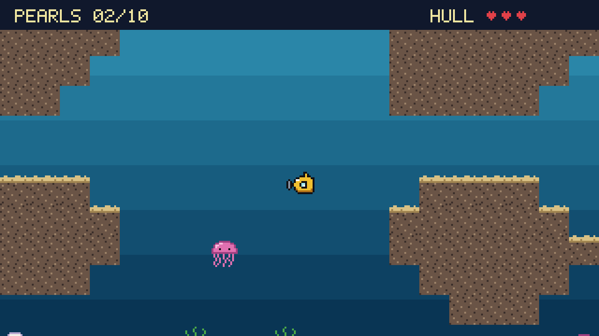

# Deep Dive

A full-screen scrolling game skeleton for the Atari816 and Horizon 0.18: a small submarine
explores an underwater cave of 64 x 24 tiles. Collect the ten pearls; keep away from the
jellyfish (three touches and you start again at the entrance). It is a teaching example:
about 1,500 lines of commented assembly (a third of it data) that use every part of "the
games round" together.



| Keys | |
| --- | --- |
| Arrow keys, W A S D, joystick 1 | move |
| Esc, Alt+F4 | leave the full screen and end |
| Alt+Tab, Alt+Esc, F12 | the desktop (the kernel's way out; the game pauses). Alt+Tab, the Windows menu or a click on its window brings the game back as it was |

## Build, run, test

```
make                    # DEEPDIVE.PRG (the art first: art/*.txt -> art/*.inc)
make run                # in the emulator, the Desktop starts it: build/run/shot1.png
make test               # test.script: the start, the gallery to the right (two pearls),
                        # down the shaft, Alt+Esc (paused), Alt+Tab (back), left, Esc;
                        # 7 screenshots in build/test/, console lines checked, Lau's
                        # register writes logged (--log-lau)
make preview            # the art, magnified (in the system palette's colours)
```
`HORIZON=...` names the Horizon tree (default `../../../horizon`). It needs REV $0B (Marga's
sprites and scroll registers: the emulator's default); on an older machine it says so in the
log and ends. Verified in the emulator (REV $0B); not run on the board.

## What it shows

| Part | Where (main.s) | Reference |
| --- | --- | --- |
| Full-screen mode, 320 x 180 x 8 bpp, a framebuffer in its own memory | `start`, `fsblk`, `getfb` | [games.md: full-screen mode](../../docs/reference/games.md#full-screen-mode) |
| Two consecutive banks from `bank_alloc` | `getfb` | [games.md: the framebuffer](../../docs/reference/games.md#the-framebuffer) |
| Fine scrolling in both directions with wrap, a fixed panel by the split | `setscroll`, `scroll`, `scrolltiles` | [games.md: scrolling](../../docs/reference/games.md#98-fs_scroll-sys_fsscroll) |
| One draw list a frame, LS_VBL on its first record | `rec_tile`, `rec_glyph`, `flush` | [games.md: draw lists](../../docs/reference/games.md#draw-lists) |
| (Horizon 0.19) The tiles as a sheet: a frame of tiles is one `sheet_draw` (SH_VBL on its first record); a frame that also changes the panel one `draw_list` | `tsblk`, `rec_tile`, `rec_snew`, `flush`, `sflush`, `s2l` | [games.md: sheets](../../docs/reference/games.md#sheets-horizon-019) |
| Text with LS_EXPAND records from a 1 bpp font | `text`, `rec_glyph`, `art/font.txt` | |
| The frame loop on `vsync`, missed frames counted | `frame` | [games.md: frame sync](../../docs/reference/games.md#frame-sync) |
| 15 sprites, one `spr_set` a frame, SPR_BEHIND, SPR_HFLIP | `setsprites`, `sprent` | [games.md: sprites](../../docs/reference/games.md#sprites) |
| Its own palette (`pal_set`), the water shaded by a raster table | `pal`, `raster` | [games.md: raster table](../../docs/reference/games.md#99-fs_raster-sys_fsraster) |
| Samples on Lau, made at run time; silence without Lau | `makesound`, `play` | [sound.md](../../docs/reference/sound.md) |
| Pause on WE_UNFOCUS, resume on WE_FOCUS, `fs_leave` and exit | `pause`, `quit` | |

## How it is made

**Memory.** The framebuffer is 336 bytes a row (21 tiles of 16 pixels; a multiple of 16, as
Marga wants) and 208 rows: 69,888 bytes, so it takes two banks. A range Marga reads may run
across consecutive banks the program owns, so `getfb` asks `bank_alloc` until it has two
banks in a row (the kernel gives the lowest free bank, so normally the first two are) and
gives back any it put aside. The sprite images are copied to `$1000` of the window (bank 0:
the program's own memory, and 16-byte aligned, which Marga needs); the tiles and the font
stay in the code bank, where Ali reads them. The map (64 x 24 bytes), the draw list (128 x
20 bytes), (0.19) the sheet records (128 x 16), the spr_set table and the two samples are in
BSS. (0.19) The tiles are registered as a sheet at the start (`tsblk`: 16 wide, the four
tiles one under the other: tile t is rows 16 t), so a tile is a 16-byte `sheet_draw` record
that the kernel checks against the sheet's size only: about 300 CPU cycles instead of about
1,300 for a `draw_list` record. The panel's letters (1 bpp: LS_EXPAND) stay draw_list
records; a frame that has both sends its tiles as draw_list copies after them (`s2l`), so a
frame is still one call. Measured with test.script: 1.73 ms of CPU a frame (1.83 ms with
draw_list only), the same pictures.

```
fbb:0000  rows 0-191: the ring of 21 x 12 tile slots (336 bytes a row)
          rows 192-207: the panel (fbb + 1 holds the rows past 195)
$00:1000  sprite images: submarine (2 frames), jellyfish (2), pearl (1), 256 bytes each
```

**The ring.** World tile (c, r) always lives in slot (c mod 21, r mod 12). The slots hold the
columns `ltx` .. `ltx` + 20 and the rows `lty` .. `lty` + 11, which is every tile the camera can
show (320 pixels are at most 21 columns, 164 rows at most 12 rows). The second set of scroll
registers is x2 = camx mod 336 and y2 = camy mod 192, with horizontal wrap (FSC_HWRAP: a row is
a ring of 336 bytes) and vertical wrap (vheight 192): Marga puts the slots in place. When the
camera crosses a tile edge, `scrolltiles` draws the one column (12 tiles) or row (21 tiles)
that comes into view, into the slots of the one that left. At 2 pixels a frame that is one
column or row every 8 frames; nothing else of the playfield is ever drawn again.

**The panel** is rows 192-207 of the framebuffer, below the ring. The first set of scroll
registers shows it (y = 192: past vheight, so it never wraps) on lines 0-31 (16 rows in
320 x 180), and the split at line 32 switches to the playfield's set. Its letters are 1 bpp
glyphs drawn by Ali (LS_EXPAND: set bits ink, clear bits paper), redrawn only when a number
changes.

**The frame.** `vsync` (which also waits until the last list is done) -> poll the events ->
the joystick -> move -> pick up / touch -> the camera -> the records of this frame (new tiles,
panel changes) -> one `draw_list` with LS_VBL on its first record -> `fs_scroll` -> `spr_set`.
The list, the scroll values and the sprites all take effect in the same vertical blank, so a
column is never drawn into a slot that is still on the screen. Syscalls a frame: `vsync`,
`win_event` (one poll, plus one per event), `joystick`, `fs_scroll`, `spr_set`, and
`draw_list` in the frames that have records (plus two `uptime` for the measurement). The test
run ends with "deepdive: bye after 456 frames, 0 missed, CPU 833 ms in all": about 1.8 ms of
CPU a frame in the emulator (frame 16.7 ms), syscalls included; the board is about twice as
slow on CPU work.

**Sprites.** The submarine, four jellyfish and ten pearls are 15 of Marga's 16 sprites, taken
with one `spr_alloc` and all set with one `spr_set` of 15 entries a frame (positions on the
screen: world minus camera, plus 16 for the panel; off-screen ones without SPR_EN). They are
SPR_BEHIND: hidden by every bitmap pixel that is not entry 0, and the water is entry 0, so they
swim in front of the water and behind rock, weed and the panel (no clipping code). SPR_HFLIP
turns the submarine.

**Colours.** In full-screen mode the program's palette is all 256 entries: `pal_set` sets 23
(the art's text files name them by number). While the screen is first drawn the palette is
black (one `pal_set` of 256 zero entries), so the bank's old contents never show. The raster
table changes entry 0 at seven lines: the water is darker towards the bottom of the screen.

**Sound.** `makesound` writes two signed 8-bit samples at 16 kHz into BSS: a "bling" (a square
wave, two notes, fading) and a "thud" (noise held for 4 samples, fading in steps). A pearl or a
touch is one `sample_play` on any free voice (SP_ANY). Without Lau (`sample_stat`: ENODEV) the
game is silent. `pause` stops the voices.

**Focus.** Alt+Tab, Alt+Esc and F12 minimize the full-screen window: the kernel shows the
desktop as it was, and the program gets WE_UNFOCUS. `pause` then waits for events (blocking:
no CPU used) until WE_FOCUS, when the kernel has put the game's screen back exactly as it was
(the framebuffer is the program's own memory; mode, scroll registers, palette, raster table and
sprites are kept by the kernel). The frame counter is read again so that the pause does not
count as missed frames.

## Files

| File | |
| --- | --- |
| `main.s` | the game |
| `art/tiles.txt` | water, rock, rock with sand, weed (img2inc text art, palette entries by number) |
| `art/sub.txt`, `jelly.txt`, `pearl.txt` | the sprites |
| `art/font.txt` | the panel's letters (font2inc) |
| `test.script` | the input of the test run |
