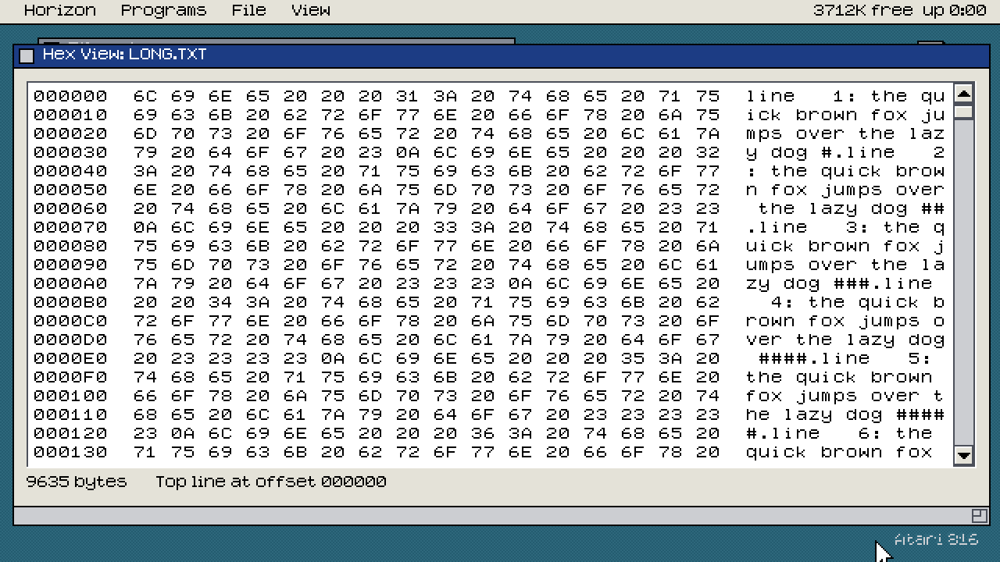

# Hex View

A small desktop utility for Horizon (Atari816): it shows any file as a hex dump. It is
an SDK example of a complete window program built on the controls library (ui.lib).



- Each line shows the offset (6 hex digits), 16 bytes in hex and the same 16 bytes as
  characters (non-printable ones as `.`). It uses the fixed 8 x 12 font, black on white,
  in a sunken box with a scroll bar at the right. A status line below the box shows the
  size and the offset of the top line.
- You can open a file three ways: **File > Open...** (ctrl+O), the argument
  (`hexview /docs/NOTES.TXT` in the shell), or by dragging a file from **Files** onto the
  window. A file over 64 KB shows its first 64 KB, and the status line says so.
- To move around: the scroll bar (arrows, track, thumb drag, mouse wheel), Up / Down (one
  line), PgUp / PgDn (one page), Home / End, and **View > Go to offset...** (ctrl+G,
  which asks for a hexadecimal offset).
- The window can be resized; the box then shows more or fewer lines and columns.
- **File > Close**, ctrl+W or the close box quits.
- Each time a file is loaded, one line goes to the console:
  `hexview: NAME, N bytes`. The test checks for this line.

## Build, run, test

```
make                     # HEXVIEW.PRG
make run                 # the Desktop starts it; a screenshot in build/run/
make test                # two scripted runs, below
make clean
```

The Makefile builds against `../../../horizon`, which is the Horizon tree of the
repository. If your Horizon tree is somewhere else, pass `HORIZON=/path/to/horizon`
(and `SDK=...` if this folder is not two levels below the SDK).

`make test` runs the program twice in the emulator:

1. **Shell mode** (`test.script`). The Makefile generates `build/BIG.BIN`, 70,000 bytes:
   the 256 byte values, lines of text, and a marker at offset 65,520. It puts the file on
   the card and starts `HEXVIEW.PRG /BIG.BIN`. The script presses PgDn, Up and End, uses
   Go to offset (the dialog, then `1f0`), the wheel and the scroll bar arrow, shrinks and
   grows the window, presses Home and closes the window with ctrl+W. The run must print
   `hexview: BIG.BIN, 70000 bytes`. The screenshots are in `build/test/shot1.png` to
   `shot10.png`.
2. **Desktop mode** (`desktop.script`). The Desktop starts the program from its Programs
   menu. The script opens the file dialog with ctrl+O and double-clicks `LONG.TXT` (a file
   on Horizon's card), then presses PgDn and End. Next it opens Files from the Programs
   menu and drags `README.TXT` onto Hex View. The run must print both
   `hexview: LONG.TXT, 9635 bytes` and `hexview: README.TXT, 110 bytes`. The screenshots
   are in `build/desk/`.

Open the screenshots and look at them. A contact sheet helps; list the files in order,
because `shot*.png` sorts `shot10` before `shot2`:
`python3 ../../tools/contact.py build/test/sheet.png build/test/shot{1..10}.png`.

## How the code is organised

Everything is in `main.s`, in this order:

| Part | What it does |
| --- | --- |
| start | `SYS_WSSTART`, `ui_init`, a bank from `SYS_BALLOC`, the window, the menus, the first layout, the argument |
| the event loop | `ui_getev` / `ui_event`, then keys, menus, resize, drop, close |
| loading a file | `SYS_STAT`, `SYS_OPEN`, two `SYS_READ`s of 32 KB into the bank, the title, the console line |
| the layout | the box, line and column counts, and the scroll bar's place and range from the window size; then everything is drawn |
| drawing the lines | `mkline` builds the text of one line from the bank, and `drawrow` draws it with a single `win_draw` |
| scrolling | `scrollto`: one `WD_COPY`, then only the new lines |
| the status line | text with its paper colour, then the rest of the line filled |

### The event loop with ui.lib

The program has one control, the scroll bar (`UT_VSCROLL`). Every event goes through
`ui_event` first. The scroll bar takes the clicks on its arrows, track and thumb, plus
the mouse wheel over the window, and redraws itself. When the user has moved it,
`ui_event` returns `UA_CHANGE`, and its `SB_POS` is the new top line. The program then
calls `scrollto`, which redraws the dump but leaves the bar alone because it is already
right. Events no control used come back as `UA_NONE`, and the program handles those:
`WE_KEY`, `WE_MENU`, `WE_RESIZE`, `WE_DROP` and `WE_CLOSE`.

The bar's fields map directly to the view:

- `SB_POS` is the top line.
- `SB_MAX` is the number of lines minus the lines shown.
- `SB_PAGE` is the lines shown.
- `SB_STEP` is one line.

When the keys move the view, `scrollto` calls `ui_sbpos`, which redraws only the thumb.
At that moment `SB_POS` must still hold the old position, because that is where the
thumb gets erased.

Dialogs come from the library as well: `ui_filedlg` (Open), `ui_ask` (Go to offset) and
`ui_alert` (errors). Each runs its own event loop until it closes.

### Loading into a bank, reading it with long addressing

A program's code, data and BSS share one 64 KB bank, so the file gets a bank of its
own. `SYS_BALLOC` returns a bank number, which goes into a 4-byte zero-page pointer,
`fptr` = bank:0000. `SYS_READ` takes a `{handle, u24 buffer, length}` block. The length
is 16 bits and a read may not cross a bank boundary, so the file is read in two halves:
32 KB to bank:0000 and, if more is left, 32 KB to bank:8000.

`mkline` reads byte Y of the file with `lda [fptr],y` (direct page indirect long, indexed
by Y). It switches to 8-bit A (`sep #$20`) for that read. A 16-bit read of the last byte,
$FFFF, would also touch the first byte of the next bank, which is not ours, and the
kernel would end the program.

A file of exactly 64 KB is 65,536 bytes, which does not fit in 16 bits. The program
therefore keeps the offset of the last byte (`lastoff`, at most $FFFF) and the number of
lines (`total`) instead of the size. The full size from `SYS_STAT` is a 32-bit value
(`fsize`); it is used for the status line and the console line, and `u32dec` converts it
to decimal.

### Scrolling with WD_COPY

A full redraw of the view takes 20 or more `win_draw` calls. Moving one line takes two:

1. `WD_COPY` moves the lines that stay. It copies the strip of the box's inside up or down
   by `d` lines. The source is x, y, w, h; the destination x goes in c1 | c2 << 8 and the
   destination y in the low word of ptr. The two areas may overlap.
2. `drawrow` draws only the `d` lines that come in, at the bottom when moving forward or
   at the top when moving back.

A jump of a page or more redraws every line. Each line is drawn as one string with a white
paper colour, so it covers what was there without clearing first. `SYS_WSHOLD` makes the
compositor wait while the copy, the new lines, the thumb and the status line are drawn,
and the screen then shows them as one change.

### The resize

The window is opened with `WF_RESIZE`. On `WE_RESIZE` (a, b = the new content size),
`relayout` does the following:

1. It computes the box size, the number of lines (`vis`), the characters per line
   (`ncols`, at most 73) and the status line's y.
2. It keeps the top line in range.
3. It moves the scroll bar and gives it a new range.
4. It redraws everything inside `SYS_WSHOLD`.

The redraw fills the whole content with the body colour first, because the old box and
status line may lie anywhere in the new area. In a narrow window each line is cut to
`ncols` characters, so the text never runs under the scroll bar. (`win_draw` clips only
to the window, not to the box.)

### Other details

- **The argument.** At the start, A holds its length and X its address in bank 0. The
  program saves both first. `args_init` and `next_arg` (ulib) then copy the first word,
  so a path in quotes may contain spaces.
- **Drop.** On `WE_DROP`, `SYS_WDROPGET` returns the string sent with the drop. Files and
  the Desktop send a file's full path.
- **Menus.** The View items start with a state byte (`MS_STATE | MS_DIM`), so they begin
  greyed out. Once a file is loaded, `SYS_WMSTATE` enables them.
- **Register widths.** A, X and Y are 16-bit everywhere. Byte stores and reads use
  `sep #$20` / `.a8` and switch straight back with `rep #$20` / `.a16`. `horizon.inc`
  sets `.smart -`, so ca65 does not track the width for you.
