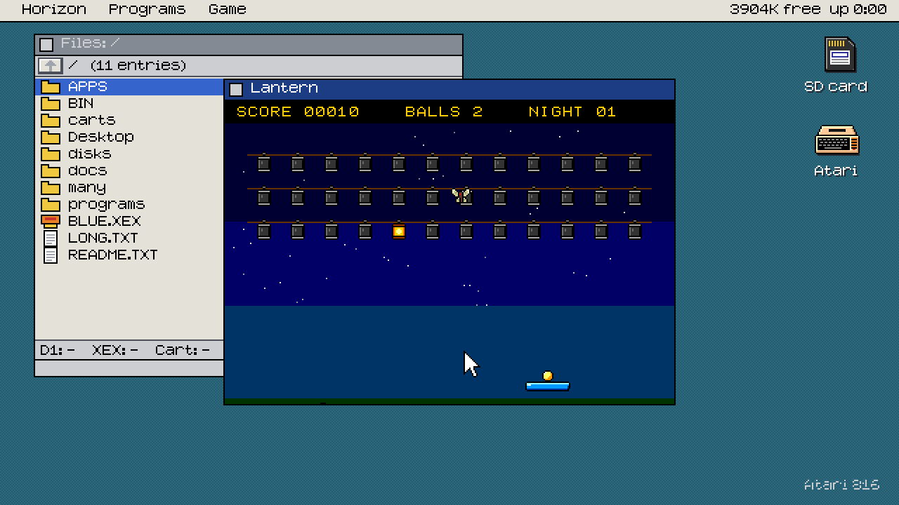

# Lantern

An arcade game for the Atari816: a paddle, a ball, 36 lanterns on three wires and a
moth. Bounce the ball into the lanterns to light them; light all of them to reach the
dawn. The moth flutters along the wires and puts out the lantern it touches (then flies
off for a while); hit it with the ball for 50 points. Three balls; every night the ball
and the moth get faster.



| Keys | |
| --- | --- |
| Left / Right, A / D, or the mouse | move the paddle (the mouse needs no button) |
| Space or a click | start; launch the ball |
| Esc | back to the title; on the title: quit |
| Game menu | New game, Quit |

## Build, run, test

```
make                    # LANTERN.PRG (the art first: art/*.txt -> art/*.inc)
make run                # in the emulator, the Desktop starts it: build/run/shot1.png
make test               # 1. played by test.script in the Desktop, 6 screenshots, sound
                        #    writes checked (--log-sound);
                        # 2. "lantern demo" in the shell: an autopilot plays until the
                        #    dawn, then lets the ball fall: the console must say
                        #    "lantern: night 1 cleared" and "lantern: game over"
make preview            # the art, magnified: build/art-*.png
```
`HORIZON=...` names the Horizon tree (default `../../../horizon`). On the machine: copy
`LANTERN.PRG` to the card (`sdk/tools/deploy816.py`), add `Lantern=/BIN/LANTERN.PRG` to
`/SYSTEM/PROGRAMS` for the Desktop's Programs menu, or type `lantern` in the Terminal.

Verified in the emulator (REV $08, with the blitter): every state (title, play, ball lost,
dawn, game over) by the two test runs; the sound only as register writes (the emulator
makes no sound). Not run on the board.

## How it is made

Lantern grew from `sdk/templates/game` (read that first): the same event loop, the same
background picture in a bank of its own, the same sound-effect engine. What is new:

**Two modules.** `main.s` is the game; `bigtext.s` draws the big letters. The Makefile
assembles both and links them into one program (`.export` / `.import` between them).
`main.s` is linked first: a Horizon program starts at the first byte of its CODE.

**The background picture** (`render`): the CPU fills a 320 x 200 picture in a bank from
`SYS_BALLOC` (64,000 bytes): the sky in bands (`skyrow` holds each row's colour), 70 stars
from a fixed random seed (the same sky every time), and the 36 lanterns. A lantern is a
24 x 16 cell (`drawlantern`): the sky of each row (the wire's colour in the hook's row),
then the 16 x 16 lantern image over it with the key colour skipped, a keyed copy done by
the CPU with long pointers (`lda [src],y` / `sta [dst4],y`). When a lantern is lit or put
out, only its cell is drawn again and copied to the window (`redrawlantern`: one WD_SBLIT).

**Sprites** (the paddle, the ball, the moth) are WD_KBLITs over the picture. Each frame a
sprite that moved is put back (WD_SBLIT of its old rectangle from the picture) and drawn
at once (WD_KBLIT). In a first version all three were erased first and drawn after: the
emulator's screenshots then sometimes caught a frame with the paddle missing. Every
win_draw shows on the screen at once, so the time between a sprite's erase and its draw
must be short (see `draw`).

**Fixed point.** The ball's position and speed are in quarter pixels (`bx`, `by`, `vx`,
`vy`): speeds of 1.75 to 3 pixels a step without fractions in the code; shift right twice
to get pixels. The side walls and the top reflect the position (x = -x), so the ball never
sits outside the field.

**The paddle's angle**: where the ball hits the paddle (8 zones of 4 pixels) chooses its
new sideways speed from `zonevx`; the speed up is the night's speed.

**Lantern hits** (`lanternhit`): the ball's 8 x 8 box against the lanterns' 16 x 16 boxes
(rows and columns 24 pixels apart, so only one lantern can be touched). If the ball was
beside the lantern before the step, it bounces sideways, else up or down, and it is put
just outside the lantern on that side (so it can never get stuck inside).

**The moth** flies across, its height from a sine table (`wob`); its centre over a lit
lantern puts it out (`motheats`), then it flies off for 5 s. The ball hitting it: +50,
gone for 8 s.

**The mouse without a button**: the window is opened with `WF_HOVER`, so it gets WE_MOTION
whenever the pointer moves over it; the paddle moves towards the pointer, at most 8 pixels
a step. Pressing a key gives the control back to the keys.

**Big letters** (`bigtext.s`): `art/bigfont.txt` is a 6 x 7 pixel font as text art;
`sdk/tools/font2inc.py --prop` makes it 1 bpp bitmaps and advance widths. `bigtext` draws
a string 1-3 times larger into an 8 bpp buffer (ink where the glyph has a bit, the key
colour elsewhere) for one WD_KBLIT. The shadow uses a second buffer: when `win_draw`
returns, the blitter may still be reading the picture of the blit it started, so a buffer
is not rewritten right after its blit.

**Sound**: two voices with envelopes (from the template): the paddle, a chime per lantern
(higher rows ring higher), a falling tone when the moth puts one out, noise when the moth
is hit, a long fall for a lost ball, a rising run at the dawn. Silenced at exit.

**The demo** (any argument): the paddle follows the ball with a random offset after every
bounce, most lanterns start lit and the moth stays away, so the run is the same every
time and reaches the dawn in about a minute; then it launches the last ball without
following it. The test checks the console lines it prints.

## Files

| File | |
| --- | --- |
| `main.s` | the game |
| `bigtext.s` | big letters from a 1 bpp font |
| `art/lantern.txt`, `ball.txt`, `paddle.txt`, `moth.txt` | the pictures (img2inc text art) |
| `art/bigfont.txt` | the big font (font2inc text) |
| `test.script` | the input of the Desktop test run |
