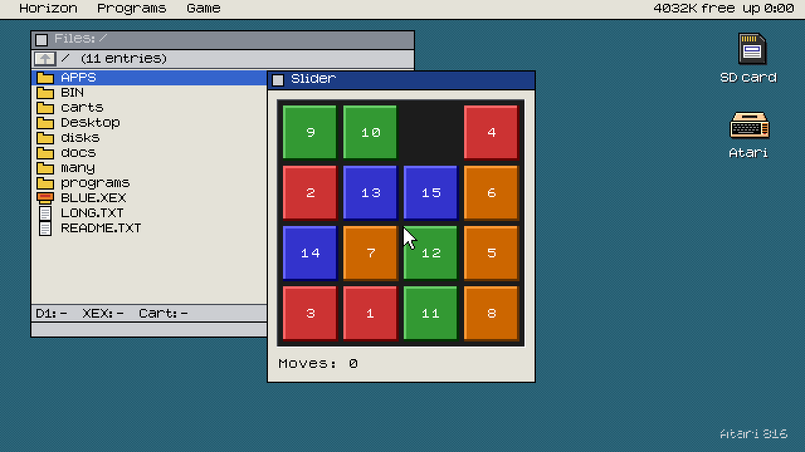

# Slider

The classic 4 x 4 sliding-tile puzzle (the "15 puzzle") for the Atari816 and its OS
Horizon: fifteen numbered tiles and one gap in a framed window. Slide the tiles until they
read 1 to 15, row by row, with the gap at the bottom right. One file of 65816 assembly
(`main.s`, about 850 lines, half of them comments), a 4 KB program.



## Playing

| Input | Does |
| --- | --- |
| Click a tile in the gap's row or column | it, and every tile between it and the gap, slide one place towards the gap (one move) |
| Arrow keys | the tile next to the gap moves in the arrow's direction into the gap (Left: the tile right of the gap moves left) |
| Game > New game, Ctrl+N | a new shuffle |
| Game > Quit, Ctrl+Q, Esc, the close box | quit |

The status line counts the moves and says "Solved!" when the puzzle is done (a little
fanfare plays). A solved board waits for New game. Every solve also prints
`slider: solved in N moves` on the console (under the Desktop it goes to the system log).

`slider -e` (easy, for tests) shuffles with two known moves instead of 200 random ones:
Up, then Left solves it.

## Build, run, test

```
make                 # SLIDER.PRG (ca65 / ld65 against ../../../horizon)
make run             # the Desktop starts it in the emulator; build/run/shot1.png
make test            # the scripted test, below
make clean
```
To build against another Horizon tree (a private copy, say): `make HORIZON=/path/to/horizon`.

`make test` runs the program twice in the emulator (`sdk/tools/run816.py`):

1. In the text shell as `/APPS/SLIDER.PRG -e`, playing `test.script`: a screenshot of the
   start, a click on tile 11 (it slides up into the gap), a screenshot, the Left key (tile
   15 slides left: solved), screenshots of the solved board, a click that must do nothing,
   Esc (the shell comes back). It checks the console for `slider: solved in 2 moves` and
   that POKEY 2 was written (`--log-sound`: the emulator makes no sound, it logs the writes
   in `build/test/emu.err`).
2. Under the Desktop with a normal shuffle: one screenshot, `build/test-desk/shot1.png`
   (that is `screenshot.png`).

Look at the pictures with `python3 ../../tools/contact.py build/sheet.png build/test/shot*.png`.

## How the code is organised

`main.s` is in parts with `----` headings; each routine has a comment saying what it takes
and gives. A, X, Y are 16-bit throughout (`.a16` / `.i16`); the only 8-bit code is
`putch`, which stores one byte (`sep #$20` + `.a8`, back with `rep #$20` + `.a16`: ca65 is
told the width by hand, it does not follow REP/SEP).

### Start

The program starts with A = the length of its arguments and X = their address. ulib's
`args_init` and `next_arg` take the first word; `-e` sets `easy`. Then the usual window
program start: `SYS_WSSTART` (it returns 1 if *we* started the window system, from the
text shell; we must then stop it at the end), `SYS_WOPEN` (a 212 x 232 content area,
centred), `SYS_WMENU` (the Game menu; the shortcut texts after a TAB are only text, the
program handles Ctrl+N / Ctrl+Q itself), and the random seed from `SYS_UPTIME`.

### The event loop

`loop` calls `SYS_WEVENT` with A = 0: the task sleeps until something happens to its
window, then gets an 8-byte event (type, window, three words a, b, c). The loop only
dispatches on the type:

- `WE_KEY` -> `onkey`: presses only (bit 8 of b); with Ctrl: N, Q; without: Esc and the
  arrows. An arrow becomes a *direction seen from the gap* (Up = "the tile below the gap")
  and `keymove` slides that tile.
- `WE_BUTTON` -> `onclick`: content coordinates in a and b. `cellof` turns x and y into a
  column and a row (dividing by the 48-pixel pitch and refusing the 4-pixel gutters).
  If the cell is in the gap's row or column, the program picks the direction and moves
  the gap one cell at a time towards the clicked tile; each step slides one tile.
- `WE_MENU` -> `onmenu`: item 0 New game, item 2 Quit (the separator counts as item 1).
- `WE_TICK` -> `fanfare`: the next note (below).
- `WE_CLOSE` -> `quit`.

Nothing polls and nothing sleeps: between events the program costs no CPU.

### The board and a move

The board is 16 words in BSS, cell 0 top left to cell 15 bottom right, each holding the
tile number 1-15, or 0 for the gap; `gap` remembers where the gap is. `neighbour` gives
the cell on one side of the gap (or carry set at the edge of the board). `swap` moves that
tile into the gap in memory only. `step1` = `swap` + draw the two cells that changed.
`moved` runs once per move, however many tiles slid: it counts, ticks, checks
`issolved` (cells 0-14 hold 1-15) and redraws the status line.

### Drawing only what changes

All drawing is `SYS_WDRAW` with a 16-byte block (`blk`). Two helpers fill it: `frect`
(a filled rectangle, the colour in A, the place in `rx`, `ry`, `rw`, `rh`) and `text`
(fixed-font text, A = ink | paper << 8).

- `drawall` (a new game only): the dark well with a one-pixel sunken edge, the 16 cells,
  the status line.
- `drawcell` (two per tile that moves): the gap is one dark rectangle; a tile is its body,
  a 2-pixel light top and left edge, a 2-pixel dark right and bottom edge (the raised
  look), and its number centred in the fixed font (8 x 12 per character). The colour comes
  from the tile's *home* row, from a small table of 6 x 6 x 6 cube colours
  (16 + 36 r + 6 g + b), so the solved board shows four stripes.
- `status`: "Moves: N" padded with spaces to 12 characters, and "Solved!" or as many
  spaces. Both are drawn with the window's paper colour (C_BODY), so new text simply
  covers the old: no clearing first, no flicker.

A move of three tiles is about 25 draw calls (~5 ms in the emulator, twice that on the
board). The window is never redrawn as a whole after the start.

### The shuffle

A random arrangement of the 15 tiles is unsolvable half the time; random *moves* from the
solved board always give a solvable position. `shuffle` makes 200 legal moves of the gap
in random directions (xorshift16, `random`), skipping a move that would undo the one
before, and starts again in the rare case the result is solved. In easy mode `newgame`
makes the two known moves (the gap left, then up) instead.

### Sound

- A tick per move: `SYS_BEEP` (A = POKEY pitch, X = length in 10 ms ticks, Y = volume),
  a 20 ms high blip. The kernel stops it by itself.
- The fanfare when solved: `fanfare_start` turns on the window timer (`SYS_WTIMER`, a
  `WE_TICK` every 120 ms) and plays the first note; each `WE_TICK` plays the next of
  C5 E5 G5 C6 (a table of {pitch, length}); after the last the timer goes off. Because the
  notes are driven by events, the window still reacts while the fanfare plays (New game
  stops it).
- `quit` and New game call `fanfare_stop`: the timer off and `SYS_BEEP` with X = 0, which
  silences every voice (sound would otherwise keep playing after the program ends).

### The end

`quit`: silence, close the window, `SYS_WSSTOP` only if `SYS_WSSTART` returned 1, then
`exit 0`.

## Ideas to extend it

A best-moves record in a file, a timer, a 3 x 3 or 5 x 5 board (the layout constants at
the top), animated sliding (`WD_COPY` of the tile a few pixels per `WE_TICK`), bigger
digits (`sdk/tools/font2inc.py`).
